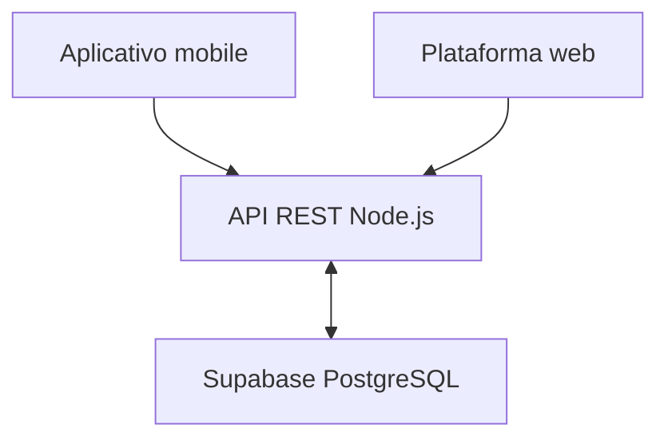

# PostoVivo SUS

### Informação acessível. Atendimento humanizado. Saúde mais próxima.

**Global Solution 2026 | CitizenTech | FIAP**


---

> Ninguém deveria enfrentar uma fila para descobrir sua posição em outra.

## 01. Apresentação

O PostoVivo SUS é uma solução CitizenTech que utiliza tecnologia para aproximar o cidadão dos serviços públicos de saúde, reduzindo barreiras de acesso à informação e promovendo autonomia, inclusão digital e transparência.

O projeto é composto por um aplicativo mobile destinado ao cidadão e uma plataforma web operacional destinada aos profissionais das Unidades Básicas de Saúde.

As duas plataformas compartilham informações por meio de uma API REST integrada a um banco de dados PostgreSQL hospedado no Supabase.

### Acesse o projeto

| Entrega | Acesso |
|---|---|
| Plataforma web | [Acessar PostoVivo SUS](https://postovivo-sus.onrender.com) |
| Repositório | [GitHub](https://github.com/biwnkw/postovivo-sus) |
| Aplicativo mobile | Disponível no diretório mobile |
| Vídeo-pitch | Em breve |

## 02. Origem do projeto

O PostoVivo SUS nasceu da observação de uma situação real vivenciada por uma das integrantes da equipe.

Uma paciente que aguardava uma consulta com uma especialista em cirurgia precisou comparecer presencialmente à unidade de saúde apenas para descobrir sua posição na fila de espera.

Mesmo sem possuir uma consulta marcada naquele dia, foi necessário realizar o deslocamento até a unidade e solicitar atendimento na recepção para obter uma informação que poderia estar disponível digitalmente.

Essa experiência revelou uma oportunidade de melhoria na comunicação entre o cidadão e os serviços públicos de saúde.

A proposta do PostoVivo SUS é transformar essa jornada, permitindo que informações sobre filas, especialistas, horários e disponibilidade de atendimento sejam consultadas diretamente pelo celular.

## 03. Problema identificado

A dificuldade de acesso às informações sobre o atendimento público de saúde pode provocar:

- Deslocamentos desnecessários até as unidades.
- Gastos com transporte.
- Tempo perdido em filas presenciais.
- Incerteza sobre a posição na fila de espera.
- Dificuldade para acompanhar encaminhamentos.
- Sobrecarga dos profissionais da recepção.
- Perda de oportunidades de atendimento.
- Exclusão de cidadãos com baixa familiaridade digital.

Essas dificuldades podem ser ainda mais relevantes para idosos, pessoas com mobilidade reduzida, pacientes em acompanhamento médico e cidadãos que dependem exclusivamente do SUS.

## 04. Proposta de solução

O PostoVivo SUS propõe uma experiência integrada de acompanhamento e organização do atendimento.

A solução foi estruturada em quatro pilares:

| Pilar | Proposta |
|---|---|
| Transparência | Consulta da posição na fila e das informações de atendimento. |
| Acessibilidade | Recursos de voz, contraste, legibilidade e navegação simplificada. |
| Eficiência | Reaproveitamento de vagas e redução de deslocamentos desnecessários. |
| Integração | Compartilhamento de informações entre cidadãos e profissionais da UBS. |

O objetivo é facilitar o acesso à informação sem substituir os profissionais de saúde ou os protocolos oficiais de atendimento.

## 05. Público-alvo

### Usuários primários

- Idosos.
- Pacientes que aguardam consultas especializadas.
- Pessoas com deficiência.
- Pessoas com mobilidade reduzida.
- Cidadãos com pouca familiaridade com tecnologia.
- Usuários do Sistema Único de Saúde.

### Usuários secundários

- Recepcionistas das UBS.
- Agentes de saúde.
- Profissionais responsáveis pelo atendimento.
- Gestores das unidades públicas de saúde.
- Familiares e cuidadores.

## 06. Jornada do usuário

### Jornada atual

| Etapa | Experiência |
|---|---|
| Encaminhamento | O cidadão recebe um encaminhamento para uma especialidade. |
| Espera | Aguarda sem acompanhar facilmente sua posição na fila. |
| Deslocamento | Precisa comparecer à unidade para solicitar informações. |
| Atendimento presencial | Aguarda atendimento na recepção. |
| Consulta da posição | Descobre sua posição na fila naquele momento. |
| Repetição | Pode precisar retornar para obter novas informações. |

### Jornada proposta pelo PostoVivo SUS

| Etapa | Experiência |
|---|---|
| Acesso | O cidadão abre o aplicativo. |
| Identificação | Informa seu código de protocolo. |
| Consulta | Visualiza sua posição e quantas pessoas estão à frente. |
| Acompanhamento | Consulta as atualizações sem sair de casa. |
| Oportunidade | Verifica se existe uma vaga de encaixe disponível. |
| Confirmação | Confirma o atendimento quando elegível. |

### Jornada do profissional da UBS

1. Acessa a plataforma web.
2. Consulta os indicadores da unidade.
3. Atualiza a presença dos especialistas.
4. Acompanha as filas por especialidade.
5. Visualiza os agendamentos.
6. Simula o contato telefônico com pacientes.
7. Registra confirmações ou desistências.
8. Disponibiliza vagas para cidadãos elegíveis.

## 07. Aplicativo mobile

O aplicativo foi desenvolvido em React Native com Expo, priorizando uma experiência simples, intuitiva e acessível.

### Funcionalidades

- Consulta de unidades de saúde.
- Informações sobre endereço e funcionamento.
- Consulta de especialistas.
- Verificação da presença dos profissionais.
- Acompanhamento da lotação da unidade.
- Entrada na fila de espera por especialidade.
- Consulta de protocolo.
- Visualização da posição na fila.
- Visualização da quantidade de pessoas à frente.
- Cancelamento da participação na fila.
- Aceitação de vagas de encaixe.
- Agendamento de consultas pela Agendinha.
- Orientações por voz.
- Configurações de acessibilidade.

## 08. Fila inteligente

O acompanhamento da fila é uma das principais funcionalidades da solução.

Ao consultar seu protocolo, o cidadão pode visualizar:

- Especialidade solicitada.
- Situação do atendimento.
- Posição atual na fila.
- Quantidade de pessoas à frente.
- Disponibilidade de encaixes.

A posição é calculada dinamicamente, considerando os protocolos ativos da mesma especialidade.

Quando um cidadão deixa a fila ou confirma um encaixe, as posições dos demais cidadãos são recalculadas.

Essa funcionalidade reduz a necessidade de comparecimento presencial à UBS exclusivamente para solicitar informações.

Na demonstração acadêmica, o sistema utiliza a ordem de entrada por especialidade. Em uma implementação real, seria necessário respeitar os critérios de prioridade clínica e regulação do SUS.

## 09. Agendinha

A Agendinha é a assistente virtual conversacional do PostoVivo SUS.

Foi desenvolvida com foco na inclusão de idosos e cidadãos que possuem dificuldades para utilizar interfaces digitais convencionais.

A proposta é permitir que o cidadão interaja com o aplicativo utilizando uma linguagem mais próxima de uma conversa cotidiana.

### Recursos

- Interpretação de comandos em linguagem natural por regras.
- Entrada de texto por digitação ou ditado do dispositivo.
- Respostas faladas em português.
- Consulta de especialidades.
- Apresentação de horários disponíveis.
- Informação sobre datas e profissionais.
- Informação sobre endereço da unidade.
- Confirmação de agendamentos.
- Geração de protocolos.

### Exemplo de interação

**Cidadão:** Quero marcar uma consulta com um cardiologista.

**Agendinha:** Encontrei horários disponíveis para cardiologia na UBS Jardim Aurora.

**Cidadão:** Quero o primeiro horário.

**Agendinha:** Sua consulta foi confirmada. Vou informar a data, o horário, o endereço e o profissional responsável.

O agendamento realizado é registrado no banco de dados e disponibilizado no painel web da unidade.

A Agendinha não realiza diagnósticos, prescrições ou orientações clínicas. Sua finalidade é exclusivamente administrativa.

## 10. Plataforma web

A plataforma web foi desenvolvida para atender às necessidades operacionais dos profissionais das unidades de saúde.

Enquanto o aplicativo prioriza a autonomia do cidadão, a plataforma web centraliza informações sobre a organização dos atendimentos.

### Painel operacional

- Indicadores de atendimento.
- Total de cidadãos na fila.
- Visualização dos agendamentos.
- Controle da presença dos especialistas.
- Atualização da lotação da unidade.
- Acompanhamento de protocolos.
- Monitoramento das filas por especialidade.

### Atendimento por voz

A plataforma possui uma funcionalidade de simulação de atendimento telefônico.

O profissional pode registrar um protocolo e reproduzir uma mensagem falada informando uma consulta ao paciente.

A resposta é simulada por meio de duas opções:

- Tecla 1: confirmar a consulta.
- Tecla 2: informar impossibilidade de comparecimento.

Quando o paciente informa que não poderá comparecer, a vaga é disponibilizada para o primeiro cidadão elegível da fila.

Essa funcionalidade representa uma alternativa de atendimento para cidadãos que não utilizam smartphones.

O projeto demonstra o fluxo de atendimento telefônico, sem realizar ligações reais.

## 11. Integração entre as plataformas

As informações do aplicativo e da plataforma web são compartilhadas por meio de uma API REST centralizada.



O backend recebe as solicitações, valida os dados, executa as operações e atualiza o banco de dados.

As plataformas consultam periodicamente o estado compartilhado para apresentar as informações atualizadas.

### Exemplos de integração

| Ação | Resultado |
|---|---|
| Profissional altera a presença de um médico na web. | Aplicativo apresenta a nova disponibilidade. |
| Cidadão entra na fila pelo aplicativo. | Painel web apresenta o protocolo e sua posição. |
| Cidadão agenda pela Agendinha. | Agendamento aparece na plataforma web. |
| Paciente cancela uma consulta na simulação telefônica. | A vaga fica disponível para encaixe no aplicativo. |
| Cidadão aceita um encaixe. | Painel web apresenta a atualização da fila. |
| Cidadão informa a lotação da UBS. | Painel web apresenta a informação atualizada. |

## 12. Banco de dados

O projeto utiliza Supabase como serviço de banco de dados, baseado em PostgreSQL.

Os dados da demonstração são armazenados na tabela postovivo_estado.

| Campo | Tipo | Finalidade |
|---|---|---|
| id | TEXT | Identificação do ambiente de demonstração. |
| dados | JSONB | Armazenamento do estado compartilhado da aplicação. |
| atualizado_em | TIMESTAMPTZ | Registro da última atualização. |

O estado compartilhado contempla:

- Informações da UBS.
- Presença dos profissionais.
- Protocolos.
- Filas de espera.
- Horários disponíveis.
- Agendamentos.
- Vagas de encaixe.
- Registros de lotação.

A persistência evita que as informações sejam perdidas quando o servidor é reiniciado.

O backend também utiliza controle de versão do estado para evitar que atualizações simultâneas sobrescrevam alterações realizadas por outros usuários.

## 13. API REST

| Método | Endpoint | Funcionalidade |
|---|---|---|
| GET | /state | Consultar o estado da unidade. |
| GET | /agenda | Consultar horários disponíveis. |
| GET | /agendamentos | Consultar agendamentos realizados. |
| GET | /fila | Consultar filas de espera. |
| GET | /events | Acompanhar eventos do servidor. |
| POST | /protocolo | Consultar protocolo individual. |
| POST | /entrar-fila | Entrar na fila de uma especialidade. |
| POST | /retirar-fila | Retirar protocolo da fila. |
| POST | /agendar | Registrar agendamento. |
| POST | /presenca | Atualizar presença do especialista. |
| POST | /lotacao | Atualizar lotação da unidade. |
| POST | /checkin | Registrar informação de movimento. |
| POST | /cadastro | Cadastrar protocolo telefônico. |
| POST | /chamar | Iniciar chamada simulada. |
| POST | /responder | Registrar resposta do paciente. |
| POST | /encaixe | Confirmar vaga de encaixe. |

## 14. Design e identidade visual

A identidade visual foi desenvolvida para transmitir confiança, acolhimento e clareza.

A escolha dos tons de verde está relacionada à saúde, ao cuidado e à tranquilidade.

A interface utiliza fundos claros, componentes espaçados, textos legíveis e elementos visuais consistentes entre as plataformas.

### Princípios de UX

- Redução da carga cognitiva.
- Priorização das informações essenciais.
- Linguagem compreensível.
- Hierarquia visual clara.
- Prevenção de erros.
- Retorno visual das ações realizadas.
- Consistência entre componentes.
- Autonomia do usuário.
- Facilidade de navegação.

A plataforma web possui uma organização voltada à gestão, enquanto o aplicativo apresenta uma experiência centrada nas necessidades do cidadão.

## 15. Acessibilidade

A acessibilidade foi considerada um requisito central do projeto.

### Aplicativo mobile

- Modo de alto contraste.
- Ajuste do tamanho dos textos.
- Áreas de toque ampliadas.
- Rótulos de acessibilidade.
- Informações apresentadas em texto e voz.
- Indicadores que não dependem exclusivamente de cores.
- Feedback tátil nas interações.
- Compatibilidade com preferências de redução de movimento.

### Plataforma web

- HTML semântico.
- Navegação por teclado.
- Indicadores de foco visíveis.
- Campos com rótulos descritivos.
- Alto contraste.
- Ajuste do tamanho da fonte.
- Layout responsivo.
- Mensagens de estado.
- Respeito às preferências de redução de movimento.

A Agendinha complementa esses recursos ao oferecer uma forma alternativa de interação para cidadãos com dificuldades de leitura ou utilização de interfaces convencionais.

## 16. Motion Design

As animações foram planejadas como recursos funcionais de comunicação.

| Aplicação | Finalidade |
|---|---|
| Transições de interface | Orientar a navegação. |
| Animações de confirmação | Informar que uma ação foi concluída. |
| Indicadores de conexão | Comunicar o estado da comunicação com o servidor. |
| Alterações visuais de estado | Facilitar a percepção de mudanças nas informações. |
| Feedback tátil | Reforçar confirmações no dispositivo mobile. |

O projeto considera usuários sensíveis a movimento, respeitando as preferências de acessibilidade do dispositivo.

## 17. Objetivos de Desenvolvimento Sustentável

### ODS 3 — Saúde e Bem-Estar

O PostoVivo SUS contribui para facilitar o acesso às informações relacionadas aos serviços de saúde, permitindo que os cidadãos acompanhem seus encaminhamentos e atendimentos com maior autonomia.

A proposta está relacionada especialmente à meta 3.8, que aborda o acesso aos serviços essenciais de saúde.

### ODS 10 — Redução das Desigualdades

A solução busca reduzir barreiras digitais enfrentadas por idosos, pessoas com deficiência e cidadãos com diferentes níveis de familiaridade tecnológica.

Os recursos de acessibilidade e interação por voz contribuem para uma experiência mais inclusiva.

### ODS 11 — Cidades e Comunidades Sustentáveis

A digitalização de informações administrativas contribui para uma utilização mais eficiente dos serviços públicos urbanos.

A redução de deslocamentos desnecessários também representa um benefício potencial para a mobilidade urbana.

## 18. Diferenciais da solução

- Acompanhamento dinâmico da posição na fila.
- Transparência sobre a quantidade de pessoas à frente.
- Assistente conversacional acessível.
- Agendamento integrado ao painel da UBS.
- Reaproveitamento de vagas por desistência.
- Simulação de atendimento telefônico inclusivo.
- Integração bidirecional entre mobile e web.
- Persistência das informações em banco de dados.
- Desenvolvimento orientado por uma necessidade real.

A inovação do PostoVivo SUS está na combinação desses recursos em uma experiência que considera diferentes níveis de autonomia digital.

## 19. Impactos esperados

### Para o cidadão

- Maior autonomia.
- Redução de deslocamentos desnecessários.
- Economia de tempo.
- Transparência sobre a fila.
- Facilidade de acesso às informações.
- Maior inclusão digital.

### Para os profissionais

- Redução de solicitações administrativas presenciais.
- Centralização das informações de atendimento.
- Melhor organização das filas.
- Aproveitamento de vagas disponíveis.

Os impactos apresentados representam benefícios esperados da solução. Sua mensuração dependeria de uma implementação piloto em unidades reais.

## 20. Tecnologias

| Camada | Tecnologias |
|---|---|
| Mobile | React Native, Expo, JavaScript |
| Voz e interação | Expo Speech, ditado do dispositivo, Web Speech API |
| Motion Design | React Native Animated, CSS |
| Feedback tátil | Expo Haptics |
| Web | HTML5, CSS3, JavaScript |
| Backend | Node.js, API REST |
| Banco de dados | Supabase, PostgreSQL |
| Hospedagem | Render |
| Versionamento | Git, GitHub |
| Desenvolvimento | Visual Studio Code |

## 21. Estrutura do projeto

```text
PostoVivo-SUS/
├── backend/
│   ├── server.mjs
│   ├── build-site.mjs
│   └── worker.mjs
├── drizzle/
├── mobile/
│   ├── App.js
│   ├── Agendinha.js
│   ├── app.json
│   ├── index.js
│   ├── package.json
│   ├── package-lock.json
│   └── .env.example
├── web/
│   ├── index.html
│   ├── style.css
│   └── app.js
├── .gitignore
└── README.md
```

## 22. Instalação e execução

### Pré-requisitos

- Node.js.
- npm.
- Git.
- Expo Go compatível com a versão do SDK.

### Clonar o repositório

```bash
git clone https://github.com/biwnkw/postovivo-sus.git
cd postovivo-sus
```

### Executar o aplicativo

```bash
cd mobile
npm ci
cp .env.example .env
```

Configure o arquivo mobile/.env:

```env
EXPO_PUBLIC_API_URL=https://postovivo-sus.onrender.com
EXPO_PUBLIC_DEMO_ROOM=demo
```

Inicie o aplicativo:

```bash
npx expo start --clear
```

Escaneie o QR Code utilizando o Expo Go.

### Executar a plataforma web localmente

Na pasta principal do projeto:

```bash
node backend/server.mjs
```

Acesse:

http://localhost:8080

### Configurar o banco de dados

No ambiente do servidor, configure:

```env
SUPABASE_URL=URL_DO_PROJETO
SUPABASE_SERVICE_ROLE_KEY=CHAVE_PRIVADA_DO_SERVIDOR
```

No Supabase, execute a seguinte estrutura SQL:

```sql
CREATE TABLE IF NOT EXISTS public.postovivo_estado (
    id TEXT PRIMARY KEY,
    dados JSONB NOT NULL,
    atualizado_em TIMESTAMPTZ NOT NULL DEFAULT NOW()
);

ALTER TABLE public.postovivo_estado
ENABLE ROW LEVEL SECURITY;

REVOKE ALL ON TABLE public.postovivo_estado
FROM anon, authenticated;

GRANT SELECT, INSERT, UPDATE, DELETE
ON TABLE public.postovivo_estado
TO service_role;
```

Sem as variáveis do Supabase, o servidor utiliza armazenamento temporário em memória para desenvolvimento local.

As chaves privadas devem permanecer exclusivamente no backend.

## 23. Segurança e responsabilidade

O PostoVivo SUS foi desenvolvido como um projeto acadêmico.

Todos os dados relacionados a unidades, profissionais, consultas e protocolos são fictícios.

A demonstração não solicita informações clínicas reais, documentos pessoais ou dados sensíveis dos cidadãos.

As credenciais do banco de dados são mantidas em variáveis de ambiente no servidor.

Uma implementação em ambiente real exigiria autenticação, autorização por perfil, auditoria, proteção dos dados pessoais, integração com os sistemas oficiais de saúde e adequação aos requisitos da LGPD.

O PostoVivo SUS não possui vínculo oficial com o Ministério da Saúde.

## 24. Possibilidades futuras

- Integração autorizada com sistemas oficiais do SUS.
- Consulta autenticada de encaminhamentos.
- Notificações sobre alterações na fila.
- Integração com serviços reais de telefonia.
- Expansão para outras unidades de saúde.
- Suporte a diferentes especialidades.
- Geolocalização de unidades.
- Reconhecimento de voz nativo.
- Testes de usabilidade com cidadãos e profissionais.
- Implementação de critérios oficiais de prioridade clínica.

## 25. Integrantes

| Nome | RM |
|---|---|
| Bianka Sousa Belmiro | 565906 |

## 26. Vídeo-pitch

Link disponível após a publicação.

## 27. Instituição

**FIAP — Web Design**

Global Solution 2026

Desafio CitizenTech

---

**PostoVivo SUS**

Tecnologia a serviço do cidadão.